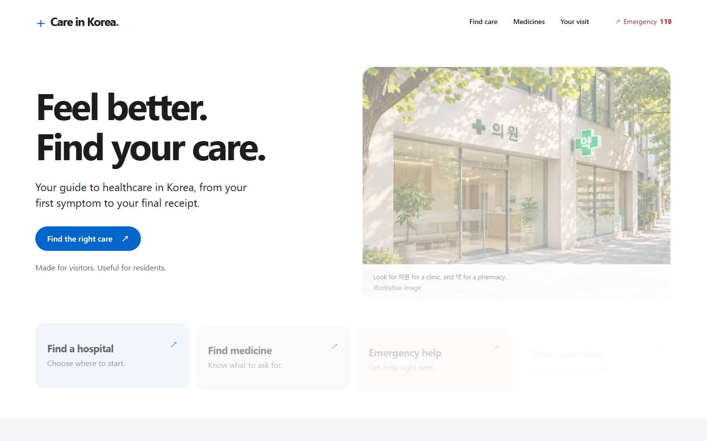

# Care in Korea

An English healthcare navigation website for visitors and foreign residents in Korea, based on the supplied JOKO pamphlet.



## Run locally

Requires Node.js 22 or newer. There are **no package dependencies** and no API keys.

```sh
node scripts/serve.mjs
```

Open http://127.0.0.1:4173. Set `PORT` to use a different port.

```sh
node --test tests/guide.test.mjs
node scripts/build.mjs
```

Seven Node tests cover the navigation data and care-level logic. The optional browser smoke script runs 22 checks using the installed `design-taste-frontend` skill's zero-dependency Edge/Chrome driver:

```sh
node tests/browser-smoke.mjs /path/to/design-taste-frontend/scripts/lib/cdp.mjs
```

The smoke test serves the built `dist/` directory, checks the user journey at four widths, and writes screenshots and a printable PDF to ignored `.taste-skill/browser/`. See [verification notes](docs/verification.md).

The build creates `dist/` with HTML, CSS, JavaScript, images, a 404 page, and Cloudflare security headers. Serve the site over HTTP; JavaScript modules do not load through `file://`.

## Deploy to Cloudflare Pages

1. In Cloudflare, open **Workers & Pages → Create application → Pages → Import an existing Git repository**.
2. Connect `Son1012/Medical-Guide-in-Korea`.
3. Set these build values:

| Setting | Value |
| --- | --- |
| Production branch | `main` |
| Framework preset | None |
| Build command | `node scripts/build.mjs` |
| Build output directory | `dist` |
| Root directory | Repository root (leave blank) |
| Node version | 22 or newer |

No environment variables, database, or backend are required. Routes use URL hashes, so nested route rewrites are unnecessary. Git integration redeploys future pushes.

Alternatively, run the build and upload the **contents** of `dist/` using Pages Direct Upload. The included `wrangler.jsonc` also supports Cloudflare Workers static assets: after building, run `npx wrangler deploy` in an environment with Wrangler access. The website has not been deployed to a Cloudflare account as part of this handoff.

[Cloudflare static HTML deployment documentation](https://developers.cloudflare.com/pages/framework-guides/deploy-anything/)

## What is included

- Four home entry points: hospital, medicine, emergency, and other essentials.
- 57 pamphlet symptom/condition topics across 10 departments, with Korean terms and readable pronunciations.
- Three user-selected care needs suggesting primary clinics, general hospitals, or tertiary hospitals. Emergency signs override the suggestion. This is navigation, not validated clinical triage.
- A five-stage visit journey: find care, prepare, consultation, payment/pharmacy, and insurance claims.
- External Google Maps and Naver Map searches by department, care level, and optional city. These are search links, not live verified provider listings.
- Seven medicine topics with ingredients, pamphlet product examples, and product-specific cautions. No individualized doses.
- Korean copy buttons, browser speech when a Korean voice is available, temporary checklists, and a printable care summary.
- Mobile layouts, keyboard support, visible focus, reduced-motion support, and a JavaScript-disabled information fallback.

## Content maintenance

`src/data.js` contains the symptom list, departments, severity descriptions, medicine entries, and source URLs. `src/app.js` contains the guide text and route views. `src/styles.css` contains the visual system.

Medical and insurance content should receive clinical/local policy review before public launch. Product names and availability may change. The pamphlet’s Dexfine–hydrocortisone pairing is explicitly flagged for pharmacist verification; fusidic acid is not presented as routine care for all wounds. Insurance eligibility and claims depend on NHIS and individual policies.

Source links and limitations appear on the website’s **About & sources** page. The original pamphlet is the supplied reference; its logo and layout have not been presented as official endorsement.

## Privacy

The app has no analytics, cookies, browser storage, accounts, or submission endpoints. Symptom selections and checklists exist in page memory and reset on reload. External links and optional browser speech use their respective services. Hosting providers still handle ordinary web requests.

## Design and assets

Apple-inspired system typography, white/gray surfaces, action blue, and a restrained layout. Installed skills used include `awesome-design`, `design-taste-frontend`, `ui-ux-pro-max`, `image-to-code`, `imagegen`, `stop-slop`, and `ponytail`.

`assets/clinic.webp` is an AI-generated illustrative Korean clinic/pharmacy scene, not a real recommended provider. Its on-page caption and About page disclose this. See [design notes and generation prompts](docs/design.md) for art direction and asset provenance.
